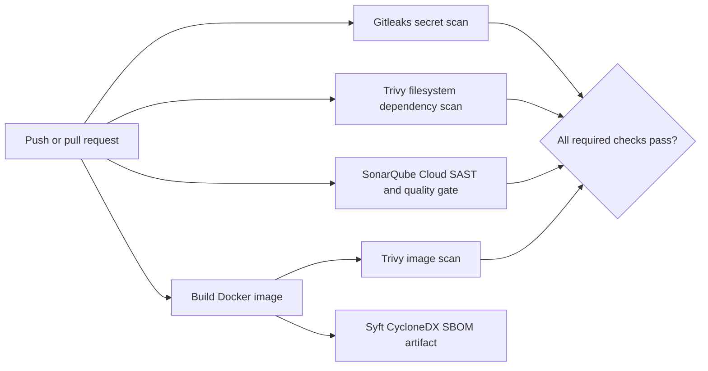

# DevSecOps CI/CD Security Gates

A recruiter-verifiable GitHub Actions portfolio demo: a deliberately vulnerable Flask service is remediated on the default branch, while the pipeline runs secret, dependency, SAST, and container checks on every push and pull request.

> **Demo only.** The `vulnerable-demo` branch is intentionally insecure. Never deploy it or use real credentials. This repository's default branch contains the fixed sample.

## Repository structure

```text
.
├── .github/workflows/security.yml  # CI security gates
├── app.py                          # Fixed Flask API
├── Dockerfile                      # Non-root runtime image
├── requirements.txt                # Pinned Python dependencies
├── sonar-project.properties        # SonarQube Cloud project settings
├── scripts/make-vulnerable.ps1     # Generates the red-build demo state
└── README.md
```

## Architecture



## What each tool catches

| Tool | Pipeline target | Example finding |
|---|---|---|
| Gitleaks | Git history/change | A committed credential or token |
| Trivy filesystem | OS and language dependencies | Known HIGH/CRITICAL CVEs in Python packages |
| SonarQube Cloud | Python source | SQL injection and maintainability/security issues; configured quality gate |
| Trivy image | Built container | Vulnerable OS packages and application dependencies |
| Syft | Built container | CycloneDX inventory for later auditing |

The Trivy gates fail on HIGH or CRITICAL vulnerability findings. The Sonar scan waits up to five minutes for the configured SonarQube Cloud quality gate and fails if that gate fails. The repository's overall Actions result is green only when every job succeeds.

## Red and green runs

The current default branch is the fixed state. To create a separate intentionally failing branch from it:

```powershell
git switch -c vulnerable-demo
./scripts/make-vulnerable.ps1
git diff
git add app.py requirements.txt Dockerfile
git commit -m "demo: introduce intentional security findings"
git push -u origin vulnerable-demo
```

The generated branch includes a fake AWS-shaped key, string-built SQL, old Flask/Gunicorn versions, and an old Python base image. Gitleaks, Trivy, and SonarQube Cloud should report their respective findings. Then push the remediation as a second commit:

```powershell
git switch master
git switch -c fixed-demo
git merge --no-edit vulnerable-demo
git checkout main -- app.py requirements.txt Dockerfile
git add app.py requirements.txt Dockerfile
git commit -m "fix: remediate demo security findings"
git push -u origin fixed-demo
```

For a clean green run, create the fixed branch from the repository's default branch and push a harmless change there (or use a release tag) so Gitleaks sees no intentionally leaked credential in its ancestry. This checkout's default branch is `master`:

```powershell
git switch master
git switch -c fixed-demo
git commit --allow-empty -m "demo: verify fixed security gates"
git push -u origin fixed-demo
```

For the clearest comparison, open a pull request from `vulnerable-demo` to the repository's default branch to show failing checks and another from `fixed-demo` to show passing checks. Keep the vulnerable branch separate: deleting a credential later does not make its Git history safe. Re-run the workflow if Trivy's live vulnerability database changes between runs.

## Screenshots

Add genuine GitHub Actions screenshots after publishing the runs; image placeholders are intentionally avoided so the README never implies unobserved results. Save them as `docs/images/vulnerable-run.png` and `docs/images/fixed-run.png`, then embed them here:

```markdown


```

Capture the workflow summary with the red/green conclusion and individual job results visible. GitHub run URLs can also be linked here.

## Set up and reproduce

1. Create a **public** GitHub repository and push the fixed default branch.
2. In SonarQube Cloud, create a free account, import the repository, and copy its organization key and project key.
3. Replace `YOUR_ORG` in `sonar-project.properties` with the organization key, and set the real project key.
4. Create a SonarQube Cloud user token. In GitHub repository **Settings → Secrets and variables → Actions**, add `SONAR_TOKEN`. No other workflow secret is required.
5. In SonarQube Cloud, set the project's quality gate to the desired policy (recommended: fail on any new issue rated Blocker/Critical and require no new vulnerabilities). The workflow waits for the project's gate result.
6. Push a commit or open a pull request. Open **Actions → Security gates** and inspect the four checks plus the SBOM artifact.
7. Follow the red/green instructions above to publish both runs. Add screenshots from the completed runs.

The scan action versions are release-pinned; the GitHub-hosted runner and Trivy vulnerability database remain live services, so results can vary as new CVEs are published. For an organization-managed environment, pin third-party actions to reviewed full commit SHAs and update them through a dependency review process.

## Lessons learned and tradeoffs

- A strict zero-vulnerability policy can block routine work due to transitive or newly disclosed CVEs. This demo gates HIGH/CRITICAL only; review exceptions and expiry dates rather than suppressing findings indefinitely.
- SonarQube Cloud requires an account token and project setup. Local Community Edition is free but needs a running server and a separate quality gate configuration.
- Parallel jobs reduce wall-clock time, while image builds and fresh vulnerability database downloads dominate pipeline duration. Caching can speed up larger projects but adds cache invalidation and trust considerations.
- Scanner findings need triage: severity is a starting point, not proof of exploitability in the deployed context.

## Resume bullets

- Built a GitHub Actions DevSecOps pipeline integrating Gitleaks, Trivy filesystem and container scans, SonarQube Cloud quality gates, and CycloneDX SBOM generation.
- Enforced HIGH/CRITICAL vulnerability gates and demonstrated failing vulnerable and passing remediated application states with least-privilege workflow permissions.

## LinkedIn summary

I built a small Flask application and automated its security checks with GitHub Actions. The pipeline runs Gitleaks, Trivy scans for dependencies and the Docker image, and SonarQube Cloud analysis with a blocking quality gate. I also added CycloneDX SBOM generation and documented vulnerable and fixed states to show how security gates affect delivery.
